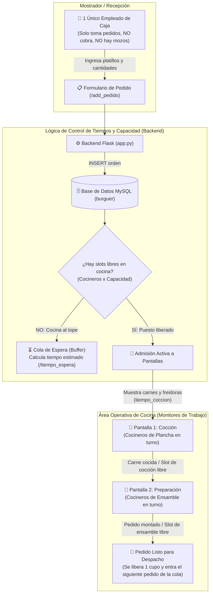
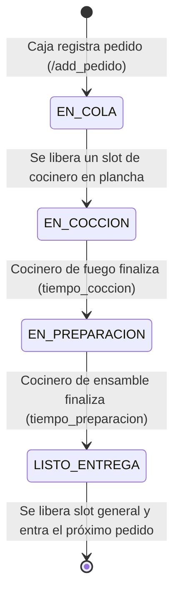
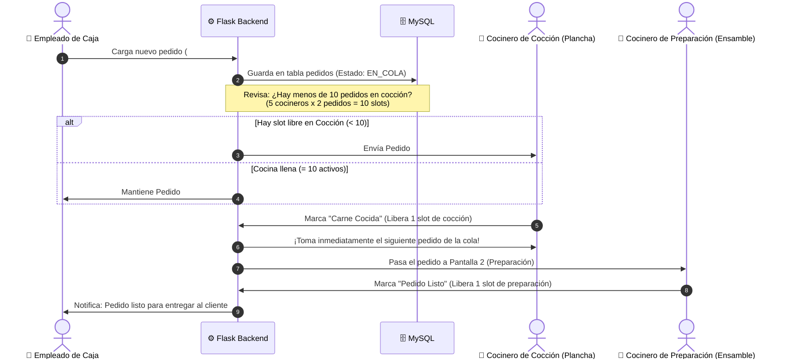

# 🍔 CronoCook — Documentación y Estructura Completa del Proyecto

> **Guía de Arquitectura, Análisis Archivo por Archivo, Separación Frontend / Backend y Sistema de Balanceo de Cocina por Capacidad**  
> *Este documento es el mapa maestro del sistema CronoCook. Explica la estructura actual, el flujo operativo real del restaurante y cómo funciona el cálculo de tiempos y puestos sin alterar el código existente.*

---

## 📌 1. Visión General y Flujo Real del Negocio

**CronoCook** es un sistema web de control de cocina y balanceo de carga (**Kitchen Display System & Queue Management**).  
A diferencia de un sistema de restaurante tradicional con mozos y cobros en mesa, **CronoCook está diseñado para una operativa rápida y optimizada**:



---

## ⏱️ 2. El Núcleo de CronoCook: Capacidad de Cocina y Cálculo de Tiempos

El corazón del sistema es **evitar que la cocina colapse** y **estimar con precisión cuándo saldrá cada pedido**.

### A. Reglas de Capacidad por Turno (Work In Progress - WIP)
1. **Puesto de Cocción (Planchas / Freidoras)**:
   - Hay $N_{coc}$ cocineros asignados al fuego en el turno actual.
   - Cada cocinero puede atender un límite de pedidos o hamburguesas simultáneas (ej. 2 o 3 pedidos a la vez).
   - **Capacidad Máxima de Cocción** = $N_{coc} \times \text{Capacidad por Cocinero}$.
2. **Puesto de Preparación (Mesa de Armado / Salsas / Empaque)**:
   - Hay $N_{prep}$ cocineros asignados al ensamblado.
   - Cada preparador toma un máximo simultáneo (ej. 2 pedidos a la vez).
   - **Capacidad Máxima de Preparación** = $N_{prep} \times \text{Capacidad por Preparador}$.

### B. Ejemplo Real del Negocio:
> *Si en el turno hay **5 cocineros en cocción** y **5 cocineros en preparación**, y cada uno puede llevar **2 pedidos a la vez**, la cocina tiene una capacidad concurrente de **10 pedidos en cocción** y **10 pedidos en preparación**.*  
> 
> *Si ingresan 15 pedidos desde caja:*
> 1. Los primeros 10 ingresan de inmediato a las pantallas activas de cocina.
> 2. Los 5 pedidos restantes **se mantienen en cola de espera (buffer)**.
> 3. En cuanto un cocinero termina una comanda y la marca como lista, **se libera un slot** y **recién en ese momento el siguiente pedido en cola aparece en pantalla**.

### C. Estados de Vida de un Pedido en CronoCook:


### D. ¿Cómo se calcula el Tiempo de Espera?
El tiempo de espera total que se le informa al cliente se calcula sumando:
1. **Tiempo de espera en cola**: Cuántos pedidos hay antes y cuándo se desocupará el próximo cocinero libre.
2. **Tiempo de cocción (`tiempo_coccion`)**: Lo que tardan las hamburguesas en la plancha/fuego.
3. **Tiempo de preparación (`tiempo_preparacion`)**: Lo que tarda el armado del pan, ingredientes y empaquetado.

Este cálculo es el motivo fundamental por el cual existe la pantalla **`tiempo_espera.html`** dentro del proyecto.

---

## ⚖️ 3. Separación Arquitectónica: Frontend vs Backend vs Base de Datos

```mermaid
graph LR
    subgraph FRONTEND ["FRONTEND (Interfaz de Usuario)"]
        CAJA_UI["Pantalla Cajero\n(add_pedido.html, menu.html)"]
        COCINA_UI["Pantallas Cocineros\n(pedidos.html con HTMX polling)"]
        ESPERA_UI["Monitor de Tiempos\n(tiempo_espera.html)"]
        CSS["Estilos Estilitos.css\n(Tickets de comandera térmica)"]
    end

    subgraph BACKEND ["BACKEND (Servidor Flask - app.py)"]
        API["Rutas HTTP y Endpoints"]
        COLA["Lógica de Agrupación y Control"]
        SQL_CON["Driver MySQL (flask_mysqldb)"]
        TRANS["Manejo de Transacciones (commit/rollback)"]
    end

    subgraph DATABASE ["BASE DE DATOS (MySQL en XAMPP - burguer.sql)"]
        TBL_C["comidas\n(tiempos de prep y cocc)"]
        TBL_P["pedidos\n(fecha y número de orden)"]
        TBL_PD["pedidos_detalles\n(cantidades por ítem)"]
    end

    FRONTEND <-->|"HTTP / HTMX (cada 10s)"| BACKEND
    BACKEND <-->|"Consultas SQL"| DATABASE
```



### 🔵 ¿Qué hace el Backend (`app.py`)?
- Escucha peticiones de la caja (`/add_pedido`) y las pantallas de cocina (`/pedidos`).
- Ejecuta consultas parametrizadas contra MySQL (`SELECT`, `INSERT`, `UPDATE`, `DELETE`) para evitar inyecciones SQL.
- Hace un `JOIN` entre `pedidos_detalles` y `comidas` para traer los nombres y cantidades reales.
- Agrupa las comandas en memoria en un diccionario (`pedidos_agrupados`) para que el frontend las dibuje con facilidad.

### 🟡 ¿Qué hace el Frontend (`templates/` y `static/`)?
- **Caja**: Formulario intuitivo donde el empleado solo coloca cuántas hamburguesas de cada tipo pide el cliente (`input type="number"`).
- **Cocina**: Muestra las órdenes con apariencia de tickets de papel térmico (`.ticket` en CSS).
- **Reactividad sin recarga**: Gracias a **HTMX** (`hx-trigger="every 10s"`), los monitores de cocina consultan el servidor en segundo plano e insertan nuevas órdenes automáticamente sin parpadeos ni necesidad de recargar la página manualmente con F5.

### 🟢 ¿Qué hace la Base de Datos (`burguer.sql`)?
- Almacena el catálogo con los dos tiempos críticos por cada hamburguesa: `tiempo_preparacion` y `tiempo_coccion`.
- Registra cada orden con su `DATETIME` de entrada exacto y el desglose de productos.

---

## 📁 4. Mapa del Árbol de Archivos del Proyecto

```text
c:/xampp/htdocs/Cronocook-main/
│
├── app.py                     ⭐ [BACKEND ACTIVO] Servidor Flask con lógica de pedidos, capacidad de turno y CRUD.
├── burguer.sql                🗄️ [BASE DE DATOS] Script de creación de tablas y datos semilla de prueba.
├── requirements.txt           📦 [DEPENDENCIAS] Librerías requeridas (flask, flask-mysqldb).
├── .gitignore                 ⚙️ [CONTROL DE VERSIONES] Ignora carpetas temporales y entornos virtuales.
│
├── templates/                 🖥️ [FRONTEND - VISTAS ACTIVAS (JINJA2 HTML)]
│   ├── index.html             -> Menú de acceso rápido a las distintas secciones con banner de capacidad.
│   ├── configuracion_turno.html -> Menú para ajustar el número de empleados en cocción y preparación.
│   ├── menu.html              -> Catálogo visual de platillos en formato tarjetas con HTMX.
│   ├── menu base.html         -> Versión anterior del menú en tabla tradicional.
│   ├── pedidos.html           -> Pantalla de tickets de cocina con filtro de capacidad y cola (HTMX 10s).
│   ├── add_pedido.html        -> Pantalla del cajero con menú visual tipo tarjetas y contadores dorados.
│   ├── add_comida.html        -> Formulario para dar de alta nuevas hamburguesas y sus tiempos.
│   ├── update_comida.html     -> Formulario para editar precios, nombres o tiempos de cocción.
│   └── tiempo_espera.html     -> Plantilla destinada a calcular y mostrar tiempos de espera y turnos.
│
├── static/                    🎨 [FRONTEND - RECURSOS ESTÁTICOS]
│   ├── CSS/
│   │   └── Estilitos.css      -> Hoja de estilos principal: tarjetas, tickets térmicos y modo oscuro.
│   ├── Imagenes/
│   │   └── favicon.ico        -> Icono de la hamburguesa para el navegador.
│   │
│   │   <!-- Archivos estáticos de prueba/copia sueltos en static -->
│   ├── add_comida2.html       -> Copia estática de respaldo.
│   ├── add_pedido2.html       -> Copia estática de respaldo.
│   ├── Estilitos2.css         -> Copia idéntica de Estilitos.css.
│   ├── index2.html            -> Copia estática de index.html.
│   ├── menu2.html             -> Copia estática de menu.html.
│   ├── pedidos2.html          -> Copia estática de pedidos.html.
│   ├── tiempo_espera2.html    -> Copia estática de tiempo_espera.html.
│   └── update_comida2.html    -> Copia estática de update_comida.html.
│
├── app/                       🧪 [RAMA EXPERIMENTAL - REFACTOR]
│   ├── requirements.txt       -> Dependencias experimentales (Litestar, Uvicorn, etc.).
│   └── source/
│       ├── main.py            -> Versión modularizada experimental.
│       ├── static/img/        -> Favicon experimental.
│       └── templates/         -> Vistas experimentales con Tailwind CSS.
│
├── resources/db/
│   └── openapi.yaml           📄 [ESPECIFICACIÓN API] Contrato OpenAPI 3.0 para consumo REST.
│
├── containers/
│   └── dev.containerfile      🐳 [CONTENEDORES] Archivo de configuración Docker/Devcontainer.
│
└── docs/
    └── readme.md              📖 [DOCUMENTACIÓN] Integrantes y comando de despliegue con Gunicorn.
```

---

## 🔍 5. Análisis Detallado Archivo por Archivo con Líneas Clave Comentadas

---

### 🟢 Base de Datos: `burguer.sql`
Define la persistencia en MariaDB/MySQL.

#### Tablas y su función en la lógica de tiempos:
- **`comidas`**: Guarda el nombre y los dos tiempos de procesamiento que usa la cocina para calcular cuándo sale el plato.
- **`pedidos`**: Genera el número de orden y guarda el instante exacto en que la caja lo cargó.
- **`pedidos_detalles`**: Relaciona el pedido con las comidas y cuántas unidades se pidieron.

#### Fragmento Clave Comentado (`burguer.sql`):
```sql
-- Tabla donde se configuran los tiempos por cada hamburguesa
CREATE TABLE `comidas` (
  `id` int(10) UNSIGNED NOT NULL AUTO_INCREMENT, -- Identificador único
  `nombre` text NOT NULL,                        -- Nombre del producto (ej: "Cheese Burguer")
  `tiempo_preparacion` time NOT NULL,            -- Tiempo de ensamblado y salsas (Pantalla 2)
  `tiempo_coccion` time NOT NULL,                -- Tiempo de plancha y freidoras (Pantalla 1)
  PRIMARY KEY (`id`)
);

-- Cabecera del pedido tomado en caja (sin cobro)
CREATE TABLE `pedidos` (
  `id` int(11) UNSIGNED NOT NULL AUTO_INCREMENT, -- Número de comanda para la cocina
  `fecha_pedido` datetime NOT NULL DEFAULT current_timestamp(), -- Momento de ingreso
  PRIMARY KEY (`id`)
);

-- Cantidades de cada ítem dentro de la orden
CREATE TABLE `pedidos_detalles` (
  `id` int(11) NOT NULL AUTO_INCREMENT,
  `id_pedido` int(11) NOT NULL,                  -- Relación con tabla pedidos
  `id_comida` int(11) UNSIGNED NOT NULL,         -- Relación con tabla comidas
  `cantidad` int(10) UNSIGNED NOT NULL DEFAULT 1,-- Unidades solicitadas por el cliente
  PRIMARY KEY (`id`),
  KEY `fk_detalle_comida` (`id_comida`),
  -- Integridad referencial: no se puede borrar una comida si está en un pedido
  CONSTRAINT `fk_detalle_comida` FOREIGN KEY (`id_comida`) REFERENCES `comidas` (`id`)
);
```

---

### 🔵 Backend: `app.py`
Es el servidor web en Flask que conecta la interfaz con MySQL.

#### 1. Configuración y Conexión MySQL (Líneas 1 a 18)
```python
from flask import Flask, render_template, request, redirect, url_for, flash
from flask_mysqldb import MySQL

app = Flask(__name__)

# Llave requerida por Flask para mensajes flash y manejo de sesiones
app.secret_key = "a_secure_random_key"

# Parámetros de conexión con el MySQL de XAMPP
app.config['MYSQL_USER'] = 'root'         # Usuario administrador por defecto
app.config['MYSQL_PASSWORD'] = ''         # Sin contraseña en instalación estándar XAMPP
app.config['MYSQL_HOST'] = '127.0.0.1'     # Servidor local
app.config['MYSQL_DB'] = 'burguer'         # Base de datos donde está burguer.sql

mysql = MySQL(app)                        # Inicializa el conector

@app.route('/')
def index():
    # Página inicial para navegar entre Menú y Pedidos
    return render_template('index.html')
```

#### 2. Gestión del Menú de Comidas (Líneas 23 a 98)
```python
# Muestra el listado de platillos disponibles
@app.route('/menu')
def menu():
    try:
        cur = mysql.connection.cursor()
        cur.execute('SELECT * FROM comidas') # Trae id, nombre, tiempos e imagen
        datos = cur.fetchall()
        cur.close()
    except Exception as e:
        # Mensaje de ayuda si el usuario olvidó prender MySQL en XAMPP
        return f"Error de conexión con la base de datos: ¿Está prendido el servidor MySQL en XAMPP? {e}"
    return render_template('menu.html', menu=datos) 

# Agrega un nuevo platillo con sus tiempos de cocción y preparación
@app.route('/add_comida', methods=['GET', 'POST'])
def add_comida():
    if request.method == 'POST':
        # Captura los datos enviados desde el formulario web
        comida = request.form['nombre']
        tiempo_preparacion = request.form['tiempo_preparacion']
        tiempo_coccion = request.form['tiempo_coccion']
        url_imagen = request.form['url_imagen']
        try:
            cur = mysql.connection.cursor()
            # Inserción parametrizada con tuplas para blindar contra inyecciones SQL
            cur.execute(
                'INSERT INTO comidas(nombre, tiempo_preparacion, tiempo_coccion, url_imagen) VALUES (%s, %s, %s, %s)',
                (comida, tiempo_preparacion, tiempo_coccion, url_imagen))
            mysql.connection.commit() # Guarda los cambios definitivamente
            cur.close()
            flash('Comida agregada correctamente')
        except Exception as e:
            mysql.connection.rollback() # Revierte la operación si hubo error
            flash(f'Error al agregar comida: {e}')
        return redirect(url_for('menu'))
    return render_template('add_comida.html')

# Elimina una comida por su ID
@app.route('/delete_comida/<int:id>', methods=['POST'])
def delete_comida(id):
    try:
        cur = mysql.connection.cursor()
        cur.execute('DELETE FROM comidas WHERE id = %s', (id,))
        mysql.connection.commit()
        cur.close()
        flash('Comida eliminada correctamente')
    except Exception as e:
        mysql.connection.rollback()
        flash(f'Error al eliminar comida: {e}')
    return redirect(url_for('menu'))

# Actualiza tiempos o datos de un producto
@app.route('/update_comida/<int:id>', methods=['GET', 'POST'])
def update_comida(id):
    if request.method == 'POST':
        comida = request.form['nombre']
        tiempo_preparacion = request.form['tiempo_preparacion']
        tiempo_coccion = request.form['tiempo_coccion']
        url_imagen = request.form['url_imagen']
        try:
            cur = mysql.connection.cursor()
            cur.execute(
                'UPDATE comidas SET nombre = %s, tiempo_preparacion = %s, tiempo_coccion = %s, url_imagen = %s WHERE id = %s',
                (comida, tiempo_preparacion, tiempo_coccion, url_imagen, id))
            mysql.connection.commit()
            cur.close()
            flash('Comida actualizada correctamente')
        except Exception as e:
            mysql.connection.rollback()
            flash(f'Error al actualizar comida: {e}')
        return redirect(url_for('menu'))
    
    cur = mysql.connection.cursor()
    cur.execute('SELECT * FROM comidas WHERE id = %s', (id,))
    item = cur.fetchone()
    cur.close()
    return render_template('update_comida.html', item=item)
```

#### 3. Control de Pedidos y Pantalla de Cocina (Líneas 100 a 173)
```python
# Consulta los pedidos que deben mostrarse a los cocineros
@app.route('/pedidos')
def pedidos():
    try:
        cur = mysql.connection.cursor()
        # 1. Trae los pedidos con su ID y fecha
        cur.execute('SELECT * FROM pedidos')
        datos = cur.fetchall()

        # 2. Con un JOIN trae el nombre legible de la comida en lugar del id numérico
        cur.execute('''
            SELECT pedidos_detalles.id_pedido, comidas.nombre, pedidos_detalles.cantidad
            FROM pedidos_detalles
            JOIN comidas ON pedidos_detalles.id_comida = comidas.id
        ''')
        items = cur.fetchall()
        cur.close()

        # 3. Lógica de Agrupación en memoria:
        # Convierte filas individuales en un diccionario agrupado por comanda:
        # { 3: [('Cheese Burguer', 2), ('Clasica', 1)] }
        pedidos_agrupados = {}
        for id_pedido, nombre_comida, cantidad in items:
            pedidos_agrupados.setdefault(id_pedido, []).append((nombre_comida, cantidad))

    except Exception as e:
        return f"Error de conexión con la base de datos: ¿Está prendido el servidor MySQL en XAMPP? {e}"

    return render_template('pedidos.html', pedidos=datos, pedidos_agrupados=pedidos_agrupados)


# Pantalla del empleado de caja para recibir y cargar el pedido
@app.route('/add_pedido', methods=['GET', 'POST'])
def add_pedido():
    # Obtiene todos los platillos para que el empleado pueda ingresar cantidades
    cur = mysql.connection.cursor()
    cur.execute('SELECT * FROM comidas')
    comidas = cur.fetchall()
    cur.close()
    
    if request.method == 'POST':
        try:
            cur = mysql.connection.cursor()
            # 1. Inserta la orden en 'pedidos' para generar el nuevo ID de comanda
            cur.execute('INSERT INTO pedidos() VALUES ()',)
            pedido_id = cur.lastrowid # Identificador generado automáticamente
            
            # 2. Lee los campos generados dinámicamente con prefijo 'cantidad_'
            for campo, valor in request.form.items():
                if campo.startswith('cantidad_'):
                    id_comida = campo.split('_')[1]       # Extrae el ID de la comida
                    cantidad = int(valor)                 # Unidades pedidas
                    if cantidad > 0:                      # Solo guarda si el cliente pidió 1 o más
                        cur.execute(
                            'INSERT INTO pedidos_detalles(id_pedido, id_comida, cantidad) VALUES (%s, %s, %s)',
                            (pedido_id, id_comida, cantidad))

            # 3. Guarda la transacción completa
            mysql.connection.commit()
            cur.close()
            flash('Pedido agregado correctamente')
            return redirect(url_for('pedidos'))
        except Exception as e:
            return f"Error de conexión con la base de datos: {e}"

    return render_template('add_pedido.html', comidas=comidas)


# Ruta reservada para el cálculo de tiempos de espera según los turnos
@app.route('/tiempo_espera')
def tiempo_espera():
    return render_template('tiempo_espera.html')
```

---

### 🟡 Frontend: Plantillas Jinja2 (`templates/`)

#### 1. `templates/index.html` (Portal de Acceso)
- Pantalla con botones grandes para ir a la gestión del Menú o a la pantalla de Pedidos.

#### 2. `templates/add_pedido.html` (Pantalla del Empleado de Caja)
- Es la herramienta de trabajo del único empleado en mostrador:
```html
<!-- Formulario donde el cajero solo ingresa cantidades sin preocuparse por cobro -->
<form action="{{ url_for('add_pedido') }}" method="POST">
    
    <label for="cantidad_{{ comida[0] }}">{{comida[1]}}</label>
    <!-- Cada input tiene como nombre 'cantidad_<id_comida>' con mínimo 0 -->
    <input type="number" name="cantidad_{{ comida[0] }}" placeholder="Cantidad de {{ comida[1] }}" min="0" value="0">
    <br>
    
    <br>
    <button type="submit">Confirmar Pedido</button>
</form>
```

#### 3. `templates/pedidos.html` (Comandas de Cocina con Auto-Polling)
- Pantalla que ven los cocineros. No requiere intervención manual para actualizarse:
```html
<!-- HTMX: Cada 10 segundos consulta /pedidos en segundo plano y reemplaza la sección sin recargar la web -->
<div class="contenedor-tickets"
     hx-get="{{ url_for('pedidos') }}"
     hx-trigger="every 10s"
     hx-select=".contenedor-tickets"
     hx-swap="outerHTML">
    
    
    <!-- Cada pedido se dibuja como un ticket térmico de comanda -->
    <div class="ticket" id="pedido-{{ pedido[0] }}">
        <div class="ticket-header">
            <h3>PEDIDO #{{ pedido[0] }}</h3>
        </div>
        
        <p class="ticket-fecha"><strong>Fecha/Hora:</strong> {{ pedido[1] }}</p>
        <div class="ticket-linea"></div>
        
        <div class="ticket-comidas">
            <p><strong>Comidas:</strong></p>
            <ul>
                <!-- Recorre los ítems agrupados de este pedido específico -->
                
                    <li>{{ cantidad }}x {{ nombre_comida }}</li>
                
            </ul>
        </div>
    </div>
    
</div>
```

#### 4. `templates/tiempo_espera.html` (Monitor de Tiempos y Cola)
- Esta plantilla está destinada a calcular cuánto tiempo demorará un pedido en función de los pedidos activos y los cocineros disponibles en el turno.

#### 5. `templates/menu.html` (Gestión del Menú)
- Muestra las tarjetas con imagen, nombre, `tiempo_preparacion` y `tiempo_coccion`.
- Utiliza **HTMX** en el botón de edición (`hx-get="{{ url_for('update_comida', id=comida[0]) }}" hx-target="body"`) para abrir el editor sin recarga completa.

---

### 🎨 Estilos Visuales: `static/CSS/Estilitos.css`
- **Tickets de Cocina (`.ticket`)**:
  - Fondo blanco hueso térmico (`#fffde7`).
  - Letra de máquina de escribir (`Courier New`).
  - Barra roja superior (`border-top: 5px solid #d32f2f`).
  - Línea de corte punteada (`border-bottom: 2px dashed #777777`).
- **Modo Oscuro General**: Fondo `#222121` para evitar cansancio visual en las pantallas de la cocina.

---

## 💡 6. Cómo se Implementa la Lógica de Slots y Puestos en el Flujo

Para que el sistema controle exactamente los límites que mencionaste (ej. **máximo 2 o 3 pedidos por cocinero**, 5 cocinando y 5 preparando, tomando 10 a la vez), el flujo lógico que se integrará a futuro sobre esta estructura es:



### Configuración de Parámetros del Turno:
En el backend o en una tabla de configuración se manejan los parámetros del turno actual:
- `COCINEROS_COCCION = 5`
- `COCINEROS_PREPARACION = 5`
- `CAPACIDAD_POR_COCINERO = 2`
- `SLOTS_COCCION_MAX = COCINEROS_COCCION * CAPACIDAD_POR_COCINERO` (10 pedidos)
- `SLOTS_PREPARACION_MAX = COCINEROS_PREPARACION * CAPACIDAD_POR_COCINERO` (10 pedidos)

---

## 🚀 7. Instrucciones para Ejecutar y Probar el Proyecto

1. **Encender XAMPP**:
   - Activar los módulos **Apache** y **MySQL**.
2. **Verificar la Base de Datos**:
   - Acceder a `http://localhost/phpmyadmin/`.
   - Confirmar que exista la base de datos `burguer` con la estructura de `burguer.sql`.
3. **Ejecutar el Servidor**:
   ```powershell
   python app.py
   ```
4. **Vistas para probar la operativa**:
   - **Caja (Empleado para cargar órdenes)**: `http://127.0.0.1:5000/add_pedido`
   - **Cocina (Monitores de trabajo)**: `http://127.0.0.1:5000/pedidos`
   - **Menú de Comidas**: `http://127.0.0.1:5000/menu`
